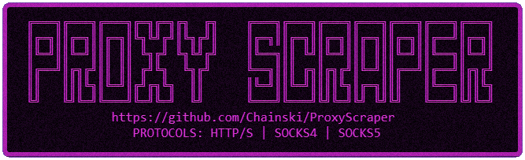

<p align="center">
   
   
   
</p>

<p align="center"> 

</p>

# 🕵️‍♂️ ProxyScraper

A high-performance multithreaded proxy scraper for Windows that fetches fresh HTTP, SOCKS4, and SOCKS5 proxies from a variety of active public sources.

*NOTE: This scraper isn't designed for production use. It's advised to use your own proxies or purchase a service which provides an API. These are merely free ones that are retrieved from sites and should only be used for development or testing purposes.*

## 📌 Features

- [x] Scrapes `HTTP/S`, `SOCKS4` and `SOCKS5` proxies
- [x] 100 actively maintained sources, every source verified online `200 OK` and updated within the last 24 hours
- [x] Worker-pool multithreading (32 threads) — typically finishes in ~2-5 seconds
- [x] Real browser fingerprint: top Windows User-Agent from [microlinkhq/top-user-agents](https://github.com/microlinkhq/top-user-agents) + browser request headers
- [x] Per-source live progress with proxy counts and fetch latency
- [x] Plain-text **and** JSON (`{"ip":..,"port":..}`) proxy extraction
- [x] Strict validation: IPv4 octets `0-255`, ports `1-65535`, loopback/reserved ranges dropped
- [x] Full deduplication on the `IP:PORT` tuple per protocol — output files contain unique entries only, sorted alphabetically
- [x] Pre-flight source check: all sources are probed in parallel before scraping, reporting `[ALL SOURCES ONLINE]` or exactly how many are reachable
- [x] Output files are rewritten fresh on every run (no accumulation)
- [x] Colorful console banners and messages (ANSI) with end-of-run statistics
- [x] Uses Windows WinHTTP API (native, no third-party deps)

## 🚀 Getting Started

### ⚙️ Requirements

- Windows OS
- C++ Compiler — either of:
  - [MinGW](https://github.com/brechtsanders/winlibs_mingw/releases) (GCC build via `build_gcc.cmd`)
  - Portable MSVC [PortableBuildTools](https://github.com/Data-Oriented-House/PortableBuildTools) (MSVC build via `build_msvc.cmd`), with `msvc.bat` available on `PATH`

### 🛠️ Build Instructions

1. Clone the repository:

```bash
git clone https://github.com/Chainski/ProxyScraper
cd ProxyScraper
```

2. Compile using MinGW (or just run `build_gcc.cmd`):

```bash
windres assets\ProxyScraper.rc -O coff -o assets\ProxyScraper.o
g++ -std=c++17 ProxyScraper.cpp assets\ProxyScraper.o -w -O2 -static -lwinhttp -fexceptions -Wl,--gc-sections -pipe -s -o proxyscraper-v2.0-x86_64-gcc.exe
```

3. Run the executable:

```bash
proxyscraper-v2.0-x86_64-gcc.exe
```

Alternatively, `build_msvc.cmd` builds with the portable MSVC toolchain from [PortableBuildTools](https://github.com/Data-Oriented-House/PortableBuildTools). It expects the PortableBuildTools environment script (`msvc.bat`) to be on `PATH`.

## 📁 Output

- `http.txt` — All scraped `HTTP/HTTPS` proxies
- `socks4.txt` — All scraped `SOCKS4` proxies
- `socks5.txt` — All scraped `SOCKS5` proxies

Files are rewritten on each run with fresh, validated and deduplicated results.

## ✅ Recommended Proxy Checker

Scraped free proxies die within hours. To find the ones that are actually online, run the output files through **[monosans/proxy-scraper-checker](https://github.com/monosans/proxy-scraper-checker)** (Rust, single Windows binary, thousands of concurrent checks, TUI progress):

- Download `proxy-scraper-checker-binary-x86_64-pc-windows-msvc.zip` from its [releases](https://github.com/monosans/proxy-scraper-checker/releases/latest)
- Use the ready-made **[proxy_checker_example/config.toml](proxy_checker_example/config.toml)** — it points at this project's `http.txt` / `socks4.txt` / `socks5.txt` directly (local paths, no conversion needed) and writes working proxies, fastest first, to `online_proxies\proxies\`, plus a JSON report with per-proxy response time and exit IP

### Tuning knobs:

| Setting | Effect |
| --- | --- |
| `timeout = 5.0 → 10.0` | Keeps slow-but-alive proxies - without it, working proxies with 5-10s responses are silently dropped |
| `timeout 5→10 + connect_timeout 3→5` | Measured on ~140K scraped: 0.66% → 1.10% online (1.65× yield), runtime ~2× longer |
| `connect_timeout = 5.0` | Lets distant working proxies through; also the main runtime driver (`total / concurrency × connect_timeout`) |
| `max_concurrent_checks = 512-1024` | Sane band. 4096+ collapsed the measured alive rate to ~0.05% vs ~1.7-2.2% at ≤1024 on a sustained run |
| `check_url` | Prefer plain unmetered endpoints (e.g. `https://checkip.amazonaws.com`). Cloudflare-fronted ones throttle bulk hits and false-fail alive proxies |

Expect ~0.5-2% of a freshly scraped public list to be online, a checker pass is the required second stage before any real use.

## 🔗 Proxy Sources
The scraper fetches proxies from 100 actively maintained sources like:
- [ProxyScrape (v2 + v4 API)](https://proxyscrape.com)
- [OpenProxyList](https://openproxylist.xyz)
- [GeoNode API](https://geonode.com/free-proxy-list)
- [ProxySpace](https://proxyspace.pro)
- [TheSpeedX](https://github.com/TheSpeedX/PROXY-List)
- [mmpx12](https://github.com/mmpx12/proxy-list)
- [monosans](https://github.com/monosans/proxy-list)
- [roosterkid](https://github.com/roosterkid/openproxylist)
- [iplocate](https://github.com/iplocate/free-proxy-list)
- [Tianndev](https://github.com/Tianndev/free-proxy)
- [dpangestuw](https://github.com/dpangestuw/Free-Proxy)
- [zloi-user/hideip.me](https://github.com/zloi-user/hideip.me)
- [VMHeaven](https://github.com/vmheaven/VMHeaven.io-Free-Proxy-List)
- [ProxyScraper/ProxyScraper](https://github.com/ProxyScraper/ProxyScraper)
- and many more...

## 👨‍💻 Author
**Chainski** [GitHub](https://github.com/Chainski)

## 📜 License
This project is licensed under the **GNU General Public License v3.0**.
You may copy, distribute, and modify the software as long as you track changes/dates in source files. All modifications must also be licensed under GPLv3. For full license text, see the [LICENSE](./LICENSE) file or visit: [https://www.gnu.org/licenses/gpl-3.0.html](https://www.gnu.org/licenses/gpl-3.0.html)
